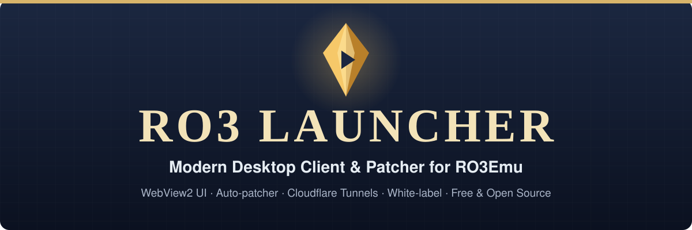

<p align="center">
  
</p>

<p align="center">
  <a href="#start-in-three-steps"></a>
  &nbsp;
  <a href="#why-ro3-launcher"></a>
  &nbsp;
  <a href="https://github.com/aethai/ro3emu-server"></a>
</p>

<p align="center">
  <a href="https://github.com/soyerno/ro3-emu-launcher/actions/workflows/ci.yml"></a>
  
  
  <a href="https://github.com/aethai/ro3emu-server"></a>
  <a href="LICENSE"></a>
</p>

Modern, lightweight, and customizable desktop game launcher and auto-patcher for **Ragnarok Online 3 / Ragnarok Origin PC (`RO3Emu`)** private servers ([aethai/ro3emu-server](https://github.com/aethai/ro3emu-server)).

Built with a dark fantasy Nordic aesthetic, decoupled **WPF + WebView2** architecture (HTML5/CSS3/JavaScript), instant live UI reload mode, automated background Cloudflare tunnel management, and DPAPI-encrypted credential storage.

> 📖 **Para leer la documentación completa en español, consulta [README.es.md](README.es.md).**

---

## Why RO3 Launcher

<table>
  <tr>
    <td width="50%" valign="top"><b>White-label out of the box</b><br>Rebrand your entire launcher for your private server in seconds. Server name, title, endpoints, news feed, and registration status are dynamically configured from <code>launcher.json</code> without recompiling C# code.</td>
    <td width="50%" valign="top"><b>Live UI Development Mode</b><br>Tweak HTML5, CSS3, and JavaScript layouts with instant live hot-reload (<code>run-ui-dev.cmd</code>). Press <code>F5</code> in the launcher window to test UI modifications on the fly without waiting for rebuilds.</td>
  </tr>
  <tr>
    <td width="50%" valign="top"><b>Seamless RO3Emu &amp; Tunnel Orchestration</b><br>Automatically detects game client folders (<code>ro3.exe</code>), injects required Cecil hooks (<code>Ro3Emu.ClientHooks.dll</code> / <code>Ro3Emu.Loc.dll</code>), and launches silent background Cloudflare access tunnels without annoying command prompt windows.</td>
    <td width="50%" valign="top"><b>Secure Account &amp; Session Storage</b><br>Player credentials and persistent authentication sessions are securely encrypted using Windows DPAPI and local SQLite databases. Supports remember-me, token revocation, and admin-controlled registration toggles.</td>
  </tr>
  <tr>
    <td colspan="2" valign="top"><b>Single-file self-contained distribution</b><br>Publishes to an all-in-one single-file Windows executable (<code>dist\Ro3Launcher.exe</code>) with embedded runtime dependencies. Players download one standalone file, click, and play without needing .NET installed on their PC.</td>
  </tr>
</table>

---

## Start in three steps

| Step | Action |
|:---:|---|
| **1** | **Clone the repository:**<br><code>git clone https://github.com/soyerno/ro3-emu-launcher.git</code><br><code>cd ro3-emu-launcher</code> |
| **2** | **Configure your server endpoints:**<br>Edit <code>launcher.json</code> and point <code>server</code>, <code>repository</code>, and <code>serverName</code> to your RO3Emu server or Cloudflare tunnel. |
| **3** | **Run or Publish:**<br>Live UI Dev: <code>run-ui-dev.cmd</code> &nbsp;·&nbsp; Build: <code>build.cmd</code> &nbsp;·&nbsp; Publish Single-File: <code>publish.cmd</code><br>Your self-contained executable is generated in <code>dist/</code>. |

---

## Architecture & Integration

RO3 Launcher operates as an autonomous desktop companion connecting players to your `RO3Emu` server:

```
[Player / WebView2 UI (HTML5 + CSS3 + JS)]
       │
       │  (Two-Way JSON IPC Bridge via WebView2)
       ▼
[RO3 Launcher Core (C# / .NET 10)]
       ├── Embedded Assets & Live Reload Engine
       ├── Auth Engine (Windows DPAPI + Encrypted SQLite)
       ├── Background Tunnel Daemon ──► [Cloudflared (Access TCP)]
       │                                     └── one local port per entry of "tunnels"
       │                                         (optional; none when the server is reachable directly)
       └── Game Orchestrator
               ├── Auto-Detect Client Path (ro3.exe)
               ├── Injects Hooks (Ro3Emu.ClientHooks & Loc)
               └── Spawns RO3Emu Join Client
```

---

## Configuration (`launcher.json`)

The launcher reads configuration from `launcher.json` embedded at compile-time or overridden on disk in the application directory:

```json
{
  "repository": "http://127.0.0.1:5380/",
  "channel": "live",
  "server": "http://127.0.0.1:5380",
  "serverName": "My RO3 Server",
  "language": "en",
  "website": "https://myserver.com",
  "discord": "https://discord.gg/your-invite",
  "statusUrl": "https://myserver.com/status.json",
  "tunnels": [{ "hostname": "ro3-http.myserver.com", "port": 5380 }]
}
```

| Field | Default | Purpose |
|---|---|---|
| `server` | `http://127.0.0.1:5380` | RO3Emu server base URL (absolute `http(s)`): sign in/registration (`/sdk/login`), status ping, and the server `RO3Emu.exe join` patches the client for. An invalid value stops launch and sign in with an error naming the field. |
| `repository` | `http://127.0.0.1:5380/` | Release repository: `channels/*.json` and `news.json`. |
| `channel` | `live` | Patch branch. |
| `serverName` | `My RO3 Server` | Name shown in the window title, captions, dialogs and e-mails. |
| `language` | `en` | Default interface and message language: `en` or `es`. Players can switch it in the launcher. |
| `website`, `discord` | none | Optional links; the buttons are hidden when empty. |
| `statusUrl` | none | Optional registration gate (see below). |
| `tunnels` | `[]` | Cloudflare tunnels to open, as `{ "hostname", "port" }`. Empty: no `cloudflared`. |

Every field is covered in the [White-Label Customization Guide](docs/guide/white-label.md).

### Registration Gating

If `statusUrl` is set, the launcher fetches it to check whether account registration is open. It reads `{"enabled": true|false}` or `{"registration_enabled": true|false}`.

When it reports `false`, the launcher displays a warning notice, disables the registration fields, and rejects client-side attempts gracefully. Without `statusUrl`, registration is assumed open.

---

## Visual Theming (HTML / CSS / JS)

The UI layer lives in [`ui.index.html`](ui.index.html), [`ui.app.css`](ui.app.css), and [`ui.app.js`](ui.app.js).

1. Execute **`run-ui-dev.cmd`** to start in live reload mode.
2. Modify styles, colors, layouts, or hero banners.
3. Right-click or press `F5` in the launcher window to preview changes instantly.
4. Run **`tools\update-logo.cmd`** with any PNG/JPG image to automatically trim transparency, generate hero assets, and compile a multi-resolution `app.ico` (16x16 to 256x256).
5. Run **`publish.cmd`** when ready to bundle your customized UI into the distributed binary.

---

## Documentation Guides

- [White-Label Customization Guide](docs/guide/white-label.md) (Every `launcher.json` field, theming, texts and languages, branded forks)
- [Architecture & IPC Guide](docs/guide/architecture.md) (WPF host, WebView2 bridge, game orchestrator)
- [Publishing & Distribution Guide](docs/guide/publishing.md) (Single-file compilation, self-contained packaging)

---

## Branded Forks

`main` is the community launcher and carries no server's brand. To ship your own configuration, news, logo, icon or executable name, keep a branch of `main` and add files under [`brand/`](brand/README.md) with the same names as the root ones; the build uses them instead of the defaults. A fork only adds files, so updating it is a plain `git merge origin/main` with no conflicts. The [`konsor`](https://github.com/soyerno/ro3-emu-launcher/tree/konsor) branch is an example of a branded fork.

---

## Companion Projects

- **[ro3emu-server](https://github.com/aethai/ro3emu-server)** — Open-source server emulator for Ragnarok Online 3.
- **[ro3-cpanel](https://github.com/soyerno/ro3-cpanel)** — White-label web administration control panel for RO3Emu.

---

## Contributing

Contributions are welcome! Please read [CONTRIBUTING.md](CONTRIBUTING.md) and [AGENTS.md](AGENTS.md) for code conventions, workflow guidelines, and pull request rules.

---

## License

Released under the [MIT License](LICENSE).
